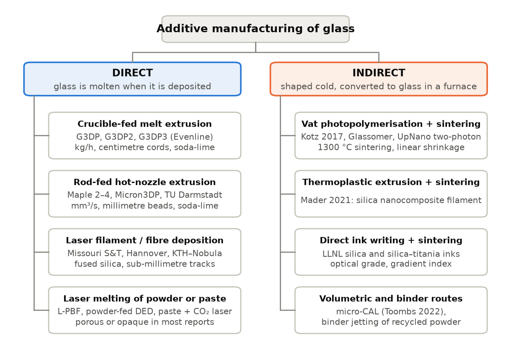
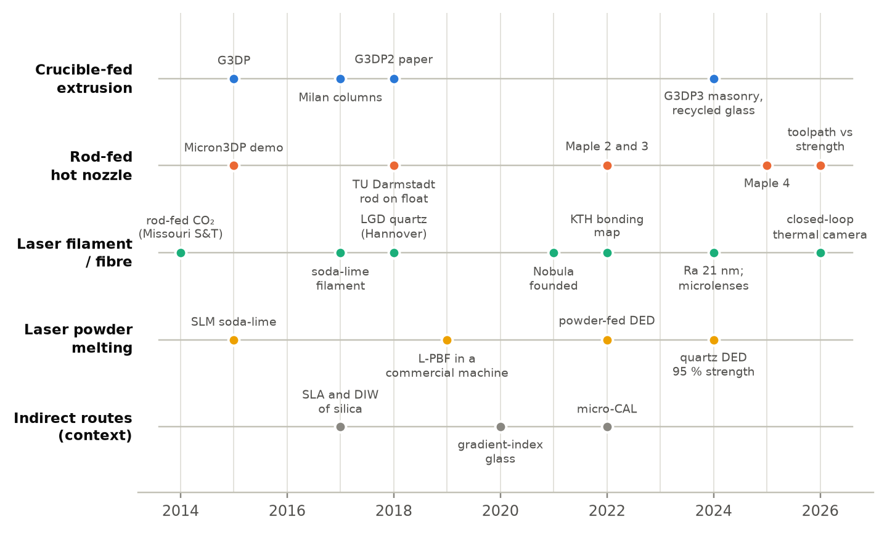
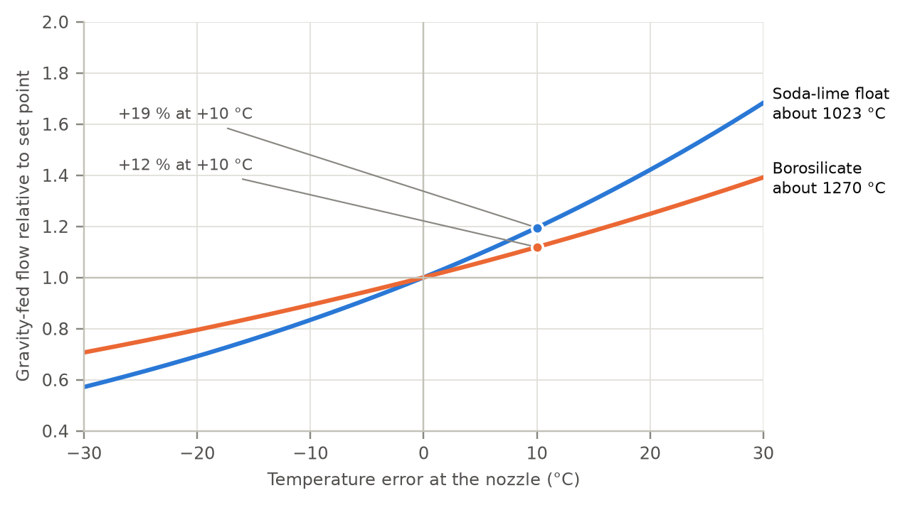
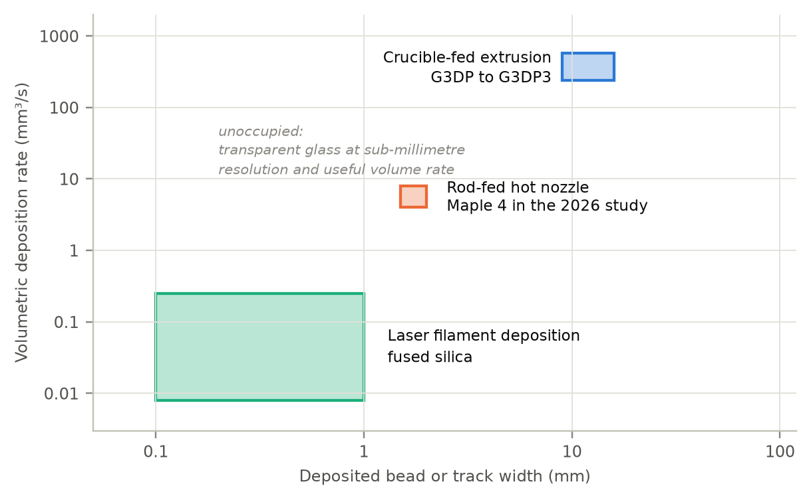

# Purpose and method

Three AI-assisted research workflows addressed the same brief on 3D printing with molten glass between 26 and 30 September 2026: Claude[^claude], ChatGPT (Codex)[^chatgpt] and Antigravity[^antigravity]. Each produced LaTeX report sources in its own workspace. Here, ChatGPT denotes the Codex workflow that produced the ChatGPT_Research_Workspace report. This summary was originally written by Claude[^summary], which is also the author of one of the three reports it compares. Codex checked and corrected the account of its own workflow in this section on 30 September; this was not an independent review of the entire synthesis. The summary merges the results into one account, keeps what is supported by a primary source, corrects what the workspaces got wrong, and leaves out what does not bear on molten-glass printing.

[^claude]: Claude Fable 5.1 from Anthropic, model ID `claude-fable-5-1` with the 1M-token context option, reasoning effort high, permission mode auto. It ran in the Claude Code extension for VS Code, version 2.1.283 for the main research on 26 September and 2.1.284 for the toolpath search on 29 September. Read from the session logs.

[^chatgpt]: Local session records identify OpenAI model `gpt-6-astra`, with high reasoning effort for the research turns; the initial model-selection question used low effort. Recorded settings were reasoning summaries off, approval policy never and sandbox `danger-full-access`. The recorded client was Codex for VS Code, with CLI 0.155.0-alpha.16.3; the extension build number was not independently established from these records. The parent thread began on 26 September and continued through 30 September, including a status turn on 27 September. It spawned academic, commercial and asset agents on 26 September, source-review and asset-completion agents on 29 September, and a final-review agent on 30 September. These form one coordinated workflow, not independent research replications. Repeated or inherited turn-context records were not counted as separate turns. The output directory is `ChatGPT_Research_Workspace`.

[^antigravity]: Gemini 3.1 Pro from Google, in Antigravity IDE 2.5.5 with language server 2.17.0. Terminal commands were set to run automatically, artifact review was set to turbo, and the terminal sandbox was off. The model was read on 30 September from the saved model selection of the IDE, last written on 26 September, and the other settings from its configuration file. The user states these are unchanged since the research. The session itself keeps no readable model record.

[^summary]: Claude Fable 5.1, model ID `claude-fable-5-1` with the 1M-token context option, reasoning effort high, permission mode auto, in Claude Code 2.1.284 for VS Code, on 30 September 2026. It continued the session that ran the toolpath search.

Every statement below was traced to the section text, notes and source files of at least one workspace. Where two workspaces disagreed, the primary paper or the archived datasheet decided. Numerical claims that rested only on a third-party listing are marked as such. All analytical figures were redrawn from one script; @sec:figures records what was changed.

Table: What each workspace contributed. {#tbl:workspaces widths=0.17,0.27,0.27,0.22}

| | Claude | ChatGPT (Codex) | Antigravity |
|---|---|---|---|
| Model and tool | Claude Fable 5.1, effort high, in Claude Code | gpt-6-astra, research effort high, in Codex for VS Code | Gemini 3.1 Pro, in Antigravity IDE |
| Size of the report | 43 pages, about 16 000 words, 147 references | 27 pages, about 8 500 body words, 43 references | 8 short sections, about 800 words, 5 references, never compiled |
| Sources on disk | 23 papers, 4 patents, 105 catalogued works | 13 papers, 3 datasheets, 3 patents | none |
| Strongest content | Breadth of the literature, quantitative machine data, open problems, group and company directories | Source qualification, unit handling, reproducible viscosity/flow/thermal and cost models, provenance of company facts | none that the other two lack |
| Main weakness | Some vendor figures taken from third-party listings; one wrong sensitivity figure; two unreadable figures | Smaller literature corpus; limited matched performance data; some requested media were not acquired | Three of five references are wrong; several factual errors |

The Codex counts were checked against the final PDF and source inventory: 27 pages, 43 cited bibliography entries, 13 research/review PDFs, three manufacturer datasheets and three patent PDFs. The approximate body count is 8 500 whitespace-delimited words extracted from PDF pages 3--23, including tables and captions; the whole PDF, including front matter and references, contains about 10 700. Its photoelasticity figure deliberately illustrates a measurement method using conventional tempered glass and is explicitly captioned as not a printed specimen. It is not presented as evidence of measured stress in printed glass. The comparison of strengths and weaknesses above is an editorial assessment, not a controlled model benchmark.

# Principal findings

1. **Two direct routes work and they do not overlap.** Crucible-fed extrusion deposits kilograms per hour of transparent soda-lime glass in centimetre-wide cords [@klein2015; @inamura2018; @mit2024masonry]. Laser filament deposition lays down fused silica at sub-millimetre scale and cubic millimetres per minute with nanometre roughness [@kth2022bonding; @lgd2024homog; @kth2024microlens]. Rod-fed hot-nozzle printers sit between them in scale [@chhadeh2026toolpath]. No process yet prints transparent glass at sub-millimetre resolution and a useful volume rate (@fig:rate).
2. **Viscosity is the governing material property.** Every process can be placed on the viscosity curve of its glass. Melt extrusion leaves the nozzle at $10^{3}$ to $10^{4.5}$ dPa·s, which soda-lime reaches near 1000 °C, borosilicate near 1270 °C and fused silica only above 2000 °C (@fig:vft). That is why fused silica is printed with lasers and not through nozzles.
3. **Thermal history controls geometry, bonding, stress and strength at once.** The heat that fuses a new cord to the layer below also lets the wall slump. A chamber held just below the annealing point is what made crack-free soda-lime prints possible [@klein2015]. The 2026 toolpath study showed that the path alone changes bending strength by about 40 % through the heat retained between passes [@chhadeh2026toolpath].
4. **Transparent is not the same as optical.** No crucible-fed part has a published transmission spectrum, wavefront error or three-dimensional stress map. Laser-filament and indirect routes have such data for small parts [@luo2018quartz; @lgd2024homog; @destino2018].
5. **Mechanical data are thin.** Reported bending strengths span 6 MPa for powder-bed parts to about 72 MPa for laser-deposited quartz (@fig:strength). Sample counts are small, test set-ups differ, and no Weibull distribution has been published for any printed glass.
6. **The contact materials limit melt extrusion.** Alumina nozzles dissolve in the melt and set campaign lengths of two to three weeks [@inamura2018]. Borosilicate and aluminosilicate extrusion needs 1250 to 1450 °C and a nozzle material that survives it.
7. **Closed-loop control exists only for temperature in laser processes.** Pyrometer and thermal-camera feedback to laser power are demonstrated [@lgd2025tempctrl; @dgf2026control]. No printer of any kind measures bead geometry and corrects it during the layer.
8. **Commercial activity is small and only partly verifiable.** Evenline sells printed objects and services, Maple Glass Printing and Nobula sell or prepare machines, and Glassomer sells materials for the competing indirect route. Current prices, yields and rated temperature limits could not be verified from primary sources.
9. **Nobody has optimised a glass toolpath for an optical target.** The forward simulation, the inverse caustic renderer and the caustic-design mathematics all exist separately [@weber2020photon; @kassubeck2021caustics; @schwartzburg2014caustics]. Their combination for a viscous glass cord is an open problem.

# Process taxonomy and history

The useful first split is whether the glass is molten when it is deposited (direct) or shaped cold and converted to glass in a furnace (indirect). Both detailed workspaces adopt it; @fig:taxonomy shows the merged version. The indirect routes share the material but not the process science. They are governed by colloid chemistry, debinding and sintering shrinkage, and appear here only as the benchmark for resolution and optical quality [@kotz2017; @nguyen2017; @toombs2022].

{#fig:taxonomy width=0.92}

The four direct families differ in feedstock and heat source.

- **Crucible-fed melt extrusion.** A charge of 2 to 25 kg is held molten in a kiln at 1040 to 1200 °C and drains by gravity through a heated ceramic nozzle into a chamber near the annealing point. This is the G3DP line from MIT, continued by Evenline [@klein2015; @inamura2018; @mit2024masonry; @stern2024cgc].
- **Rod-fed hot-nozzle extrusion.** A solid rod is pushed into a small nozzle at 900 to 1000 °C, as in polymer filament printing. Only a few millimetres of glass are molten. Maple Glass Printing, the earlier Micron3DP machines and the TU Darmstadt rod-on-float work belong here [@chhadeh2026toolpath; @seel2018; @micron3dp_acers].
- **Laser filament or fibre deposition.** A fibre of 0.1 to 0.2 mm or a rod of 1 to 3 mm is fed into a CO₂ laser focus and wets the substrate. There is no nozzle in contact with the melt. Three groups developed it under three names: digital glass forming at Missouri S&T and Notre Dame [@luo2017sodalime; @kinzel2025dgf], laser glass deposition in Hannover [@witzendorff2018; @lgd2021coaxial], and direct glass laser deposition at KTH and Nobula [@kth2022bonding].
- **Laser melting of powder or paste.** Powder-bed fusion and blown-powder deposition melt glass locally but leave 5 to 12 % porosity and opaque parts in most reports [@fateri2015; @datsiou2019; @datsiou2021; @spirrett2023]. Coaxial powder-fed quartz and paste with in-situ laser melting reach dense glass [@lang2024; @paste2024].

{#fig:timeline width=0.98}

The field moved through three phases (@fig:timeline). From 2014 to 2018 the routes were demonstrated: rod-fed CO₂ laser printing at Missouri S&T, G3DP and G3DP2 at MIT, and quartz-fibre deposition in Hannover [@luo2014jmse; @klein2015; @inamura2018; @witzendorff2018]. From 2019 to 2022 process windows were mapped and the first desktop machines appeared [@datsiou2019; @kth2022bonding]. Since 2023 the work has turned to application and control: recycled-glass masonry, optical surfaces of 21 nm roughness, real-time temperature control, and the first systematic strength study of a rod-fed printer [@mit2024masonry; @lgd2024homog; @dgf2026control; @chhadeh2026toolpath].

# Physics that sets the process window

## Viscosity

Viscosity over the whole forming range follows the Vogel–Fulcher–Tammann form

$$ \log_{10}\eta = A + \frac{B}{T - T_0} $$

with $\eta$ in dPa·s. Four reference points locate a process on the curve: the strain point at $10^{14.5}$, the annealing point at $10^{13}$, the softening point at $10^{7.6}$ and the working point at $10^{4}$ dPa·s. One dPa·s is 0.1 Pa·s, so a curve quoted in Pa·s sits one decade lower; the two workspaces used different units and the constants must not be mixed.

![Viscosity of four glass families fitted to manufacturer fixed points. Curves are solid inside the fixed points and dashed where extrapolated. The hollow markers are the fixed points of a second silica grade and show how much a family name leaves open. The black diamond is the measured G3DP nozzle-exit state [@klein2015].](figures/fig_vft_viscosity.png){#fig:vft width=0.95}

Table: Fitted constants for $\eta$ in dPa·s and temperature in °C. A dagger marks fits with $A$ fixed at the universal high-temperature limit [@mauro2009] because only three fixed points are published. {#tbl:vft widths=0.30,0.09,0.11,0.11,0.29}

| Glass | $A$ | $B$ (K) | $T_0$ (°C) | Temperature at $10^{4}$ dPa·s |
|---|---|---|---|---|
| Soda-lime float [@valleydesign_sls] | −2.39 | 5210 | 206 | 1023 °C |
| BOROFLOAT 33 borosilicate [@schott_borofloat] | −1.68 | 6578 | 112 | 1270 °C |
| EAGLE XG boro-aluminosilicate† [@corning_eaglexg] | −1.93 | 6947 | 250 | about 1420 °C, extrapolated |
| Lamp-grade fused quartz† [@heraeus_quartz] | −1.93 | 13351 | 317 | above 2000 °C, extrapolated |

Three points follow from @fig:vft and @tbl:vft.

- The two workspaces fitted BOROFLOAT 33 independently and obtained the same constants. Their soda-lime fits use different products, float glass and SCHOTT AR-GLAS tubing [@schott_arglas], and agree to within 20 °C at the working point.
- A family name is not a material law. Lamp-grade fused quartz and the synthetic high-hydroxyl grade HPFS 7980 differ by 125 to 230 °C at the same viscosity [@heraeus_quartz; @silica_hpfs].
- Any silica working point is an extrapolation of more than 300 °C beyond the last published fixed point. It shows that a nozzle process is out of reach. It is not an operating temperature.

Evenline recalibrates its machine for a new soda-lime source by setting two fitted curves equal and solving for the temperature that gives the proven viscosity. This predicted a set point of 1037 °C for float glass from 1023 °C for studio glass, and the first print came within 3.2 % of the predicted mass [@stern2024cgc]. The working range of six soda-lime compositions was nearly constant at about 295 °C.

## Flow through the nozzle

The melt moves at a Reynolds number near $10^{-4}$, so the Hagen–Poiseuille law applies:

$$ Q = \frac{\pi r^{4}}{8\,\eta L}\,\Delta p, \qquad \Delta p = \rho g H . $$

Flow scales with the fourth power of bore radius and inversely with viscosity. More than half the resistance of the G3DP crucible and nozzle sat in the last 10 mm of bore [@klein2015]. Flow also falls as the crucible empties, which is why G3DP2 raised the ratio of reservoir to print volume from 4.6 % to 29 % [@inamura2018]. Rod-fed and filament-fed machines avoid the drift because a motor sets the volume rate.

{#fig:flow width=0.80}

A 10 °C error at the soda-lime working point changes the flow by about 19 % (@fig:flow). The Claude monograph stated 30 %, which its own fit does not support. The conclusion stands: nozzle temperature has to be held within a few degrees. A heater set point is not the glass temperature. G3DP measured 920 °C at the exit against a nozzle-kiln set point of 1010 °C [@klein2015].

## Capillary instability, slump and coiling

A water jet breaks into drops spaced 4.5 diameters apart. Molten glass is in the opposite limit: the Ohnesorge number of a 10 mm soda-lime cord is of order $10^{3}$, inertia is irrelevant, and the growth rate is set by the visco-capillary time $\eta a/\sigma$ (@fig:capillary). For a G3DP cord this is about 16 s at the nozzle and rises by five orders of magnitude within a few layers, so the cord never breaks up. The same time scale governs how far surface tension smooths the seam between layers. In laser fibre printing the time is about 10 s at full temperature, and a fibre held hot for that long necks and detaches [@dgf2026control].

![Growth rate of the capillary instability of a liquid cylinder in the inviscid limit and in the viscous limit that applies to molten glass [@rayleigh1878; @tomotika1935].](figures/fig_capillary_instability.png){#fig:capillary width=0.98}

Slump is a race between gravity and cooling. The sag velocity scales as $\rho g h a^{2}/\eta$: millimetres per second at the nozzle and micrometres per second once the glass has cooled by 350 °C. This explains the empirical limits of the G3DP machines: overhangs of 30 to 35°, turning radii of 6 to 15 mm and layer heights up to 5 mm [@klein2015; @mit2024masonry]. If the nozzle is lifted well above the part, the falling cord coils like a rope. The pattern is selected by fall height and travel speed and can be programmed [@brun2017].

Marangoni flow is negligible in the large cord of a crucible-fed printer and significant in laser melt pools, where surface temperature gradients reach thousands of kelvin per millimetre [@machines2026meltpool]. In nozzle printing the dominant interfacial effect is glass wetting the nozzle face and pulling the cord sideways [@inamura2018].

## Cooling and residual stress

A lumped model of radiation and convection shows how cord diameter and surroundings set the cooling rate (@fig:cooling).

{#fig:cooling width=0.98}

The heated-chamber case reproduces the measured drop of about 350 °C across five layers in G3DP [@klein2015]. It also shows why thin beads allow bridges and overhangs but need a heated enclosure. The Maple 4 used in the 2026 study prints into a 500 °C chamber for this reason [@chhadeh2026toolpath].

The stress frozen in by a temperature difference $\Delta T$ across a wall is of order

$$ \sigma \approx \frac{E\,\alpha\,\Delta T}{2(1-\nu)} , $$

about 40 MPa per 100 °C for soda-lime, which is comparable to its practical strength. The expression is a scale and not a prediction for a free three-dimensional part. Fused silica, with an expansion coefficient eighteen times smaller, tolerates the gradients of laser deposition. Stress relaxes in about 15 minutes at the annealing point and in hours at the strain point. Thermal diffusion time grows with the square of thickness, about 40 s for 5 mm and 10 minutes for 20 mm, so the thickest section sets the schedule.

# Machines

## Crucible-fed extrusion

Three separately heated zones sit above a moving build plate (@fig:crucible). The melter conditions the glass, the nozzle meters it, and the chamber keeps the growing part rigid but close to stress-free.

![Thermal zones of a crucible-fed printer of the G3DP type and the process chain around it. Temperatures and dimensions from the G3DP and G3DP2 papers [@klein2015; @inamura2018].](figures/fig_crucible_printer.png){#fig:crucible width=0.95}

Table: The three generations of the crucible-fed platform. {#tbl:g3dp widths=0.20,0.23,0.25,0.25}

| | G3DP (2015) | G3DP2 (2018) | G3DP3, Evenline (2024) |
|---|---|---|---|
| Glass charge | 2.1 kg | 25.5 kg | not reported |
| Melter temperature | 1040–1165 °C | 1090 °C | up to 1200 °C |
| Nozzle | alumina, 10 mm bore | alumina, 11.5 mm bore | ceramic, redesigned |
| Chamber | heated, near the annealing point | 480 °C, 12 kW | heated, with infrared camera |
| Build volume (mm) | 250 × 250 × 300 | 320 × 320 × 350 | 325 × 325 × 380 |
| Deposition rate | about 2.2 kg/h | 5.2 kg/h, 570 mm³/s | feed 6–20 mm/s |
| Motion | kiln on X–Y, bed on Z | fixed kiln, four-axis bed | not reported |

G3DP2 moved the bed and kept the thermal module still, held ten 200 mm cylinders within 0.7 mm of diameter, and printed the 3 m columns shown in Milan in 2017 as stacked segments [@inamura2018]. Its thermal module draws 15 kW while printing. G3DP3 prints studio, container and float glass, including recycled cullet, with beads 9 to 16 mm wide and 3 to 6 mm high [@mit2024masonry; @stern2024cgc]. Neither machine can interrupt the flow, so every part is one continuous path. That constraint shaped the figure-eight masonry unit in @fig:g3dp3.

![Left: the G3DP3 printer with the build chamber below the furnace. Right: interlocking masonry units printed on it. Both from Massimino et al. [@mit2024masonry], CC BY 4.0, scaled to a common height and placed side by side.](figures/fig_g3dp3_photos.png){#fig:g3dp3 width=0.98}

## Rod-fed hot-nozzle extrusion

The best-documented operating point is the Maple 4 in the 2026 strength study: 3.5 mm soda-lime rod, nozzle tip at 940 °C, 1.5 mm outlet, lines 2 mm wide and 1 mm high at 4 mm/s, chamber at 500 °C [@chhadeh2026toolpath]. That is about 8 mm³/s. The company also builds a machine that draws rod from cullet. Micron3DP showed a similar concept in 2015 and claimed borosilicate printing at 1640 °C; the claim was never documented and no activity was found after 2021 [@micron3dp_acers]. Corning filed and abandoned an application for an induction-heated platinum–rhodium version [@patent_corning2021].

## Laser filament deposition

A laser head replaces the nozzle with a focused beam, so nothing touches the melt (@fig:laser). Three groups developed the hardware.

![A laser filament deposition head. Parameter ranges from the Missouri S&T, Hannover and KTH studies [@luo2017sodalime; @witzendorff2018; @kth2022bonding].](figures/fig_laser_filament_head.png){#fig:laser width=0.92}

- **Missouri S&T and Notre Dame.** Rod, filament and stripped telecom fibre as feedstock; a melt-temperature model validated by spectroscopy; a narrow window between incomplete fusion and bubble formation; side-injected heating of the interface; thermal-camera feedback on a real-time platform in 2026 [@luo2017sodalime; @luo2017heat; @hostetler2018fiber; @capps2021interface; @dgf2026control].
- **Hannover.** Quartz fibre at 120 W up to 300 mm/min; a coaxial head that heats the fibre symmetrically to lower stress; fully dense silica with 21 nm roughness at 90 mm/min, rising to 220 nm at 180 mm/min [@witzendorff2018; @lgd2021coaxial; @lgd2024homog].
- **KTH and Nobula.** Four beams from a 25 W laser, 196 µm fibre fed at 150 % of the geometric rate, 200 µm layers; bonding width mapped against power, speed and feed; a 105-layer wall without stress birefringence; microlens arrays printed in under ten seconds per lens [@kth2022bonding; @kth2024microlens].

## Powder and paste routes

Laser powder-bed fusion of soda-lime in a commercial machine gave about 12 % porosity and 6 to 7 MPa bending strength; a heat treatment at 650 °C improved translucency [@datsiou2019; @datsiou2021]. Milled powder reached 95 % density [@slmirregular2023] and borosilicate powder 94 % [@boro2025laser]. Powder blown onto bottles is proposed for decoration [@spirrett2023]. Coaxial powder-fed quartz reached 72 MPa, 95 % of conventional quartz [@lang2024].

## Comparison

Table: Reported envelope of each direct route, with the two main indirect routes for contrast. "n.r." means not reported in a primary source. {#tbl:compare widths=0.14,0.18,0.15,0.16,0.15,0.15}

| Route | Glass and temperature | Feature size | Deposition rate | Optical state | Bending strength |
|---|---|---|---|---|---|
| Crucible-fed extrusion | soda-lime; melter 1040–1200 °C, chamber 480–525 °C | bead 9–16 mm wide | 240–570 mm³/s | transparent, dense, ribbed surface; spectrum n.r. | 41–56 MPa annealed |
| Rod-fed hot nozzle | soda-lime; nozzle 940–1000 °C | bead 1.5–2 mm | about 8 mm³/s | transparent to translucent; n.r. | 40–56 MPa by orientation |
| Laser filament | fused silica at 1700–2200 °C; also soda-lime, borosilicate | 0.1–1 mm | about 0.01–0.25 mm³/s | dense, 21 nm roughness; 0.12 nm on lenses | n.r. |
| Laser powder-bed | soda-lime, borosilicate, silica | about 0.1 mm tracks | n.r. | opaque as built | 6–7 MPa |
| Powder-fed laser deposition | quartz, soda-lime | millimetre tracks | n.r. | semi-transparent to transparent | 72 MPa (quartz) |
| Indirect: photopolymer and sintering | fused silica; sinter 1300 °C | tens of micrometres | n.r. | transparent; 6–60 nm roughness | n.r. |
| Indirect: direct ink writing | silica, silica–titania | sub-millimetre | n.r. | optical grade after polishing | n.r. |

{#fig:rate width=0.85}

Rates are deposition rates. None includes annealing, finishing or rejected parts, and they must not be read as production rates.

# Thermal management, sensing and control

Three thermal architectures are in use. Crucible-fed and heated-chamber rod-fed printers keep the whole part just below the annealing point. Laser and powder processes use a build plate at 250 to 600 °C and anneal afterwards, which suits fused silica and is marginal for soda-lime [@datsiou2019; @spirrett2023]. Torches and secondary beams serve as local auxiliaries. A heated chamber is not an anneal: G3DP2 soaks the part at 525 °C and then moves it to a separate oven [@inamura2018].

Sensing has four layers.

- **Thermocouples** control every kiln zone but read the refractory and not the glass.
- **Thermal cameras** at 7.9 µm read the cord surface because glass is opaque there. G3DP3 records peak cord temperatures of 969 to 1059 °C depending on the glass and corrects set points between prints from the difference between printed and predicted mass [@stern2024cgc]. Readings depend on assumed emissivity, viewing angle and reflections from hot walls.
- **Pyrometers and spectrometers** on laser melt pools detect the onset of bubble formation and feed back to laser power [@luo2017heat; @lgd2025tempctrl].
- **Cameras** are used for observation. The Hannover platform images the transmitted wavefront of the finished part to find bubbles and striae [@lgd2024homog].

The 2026 controller for digital glass forming put a thermal camera into a deterministic control loop and showed that multilayer walls fail at constant laser power and succeed under feedback [@dgf2026control]. On crucible-fed machines the flow cannot be changed within a layer, so geometry is controlled through travel speed. G3DP ran the bed 7 % faster than the natural exit speed for the most uniform cord [@klein2015]. Bead cross-section follows from mass conservation, so a slowdown at a corner thickens the wall unless the flow changes with it.

Residual stress is checked with a polariscope. The published readings are qualitative [@klein2015; @kth2022bonding]. Quantitative methods for complex glass shapes exist and have not been applied to printed glass [@aben2008].

# Properties of printed glass

## Optical

Optical quality has four separate parts: bulk transmission, scattering, wavefront error and surface form. A ribbed wall can transmit most of the light and still distort every image (@fig:caustics). The evidence is uneven.

![Lamps printed on the G3DP platform and lit from above. Each cord acts as a cylindrical lens and the wall projects caustics. Photograph by Neri Oxman, Wikimedia Commons, CC BY-SA 4.0 [@commons_caustics].](figures/commons_caustics.jpg){#fig:caustics width=0.72}

- Crucible-fed parts are documented by photographs and caustic projection. Cut faces were polished for testing [@klein2015; @mit2024masonry].
- Laser-filament parts have measured transmission and index homogeneity for fused quartz, a wavefront free of bubbles and striae, and lens surfaces of 0.12 nm roughness [@luo2018quartz; @lgd2024homog; @kth2024microlens].
- Index homogeneity against commercial optical glass is published only for the indirect ink-writing route, on polished parts [@destino2018].

Bubbles come from gas released when the melt is reheated, from air trapped where a filament fails to wet the layer below, and from the pores between powder particles [@luo2017heat; @kth2022bonding; @datsiou2021]. Devitrification has not been reported in crucible-fed prints, but those papers also report no diffraction measurement, so the absence is not established.

## Mechanical

The published strength values come from five studies with different tests (@fig:strength).

![Bending strength reported for printed glass. The tests differ in geometry, surface state and sample count, so the chart shows what has been measured and is not a ranking [@chhadeh2026toolpath; @lang2024; @inamura2018; @datsiou2021].](figures/fig_bending_strength.png){#fig:strength width=0.95}

- G3DP samples differed by about 40 % in strength between the two test orientations, and samples printed cold had one fifth of the strength of those printed into the heated chamber [@klein2015].
- Eight annealed G3DP2 cylinders gave 41 to 56 MPa. The Milan columns were designed with a safety factor of ten [@inamura2018].
- Printed masonry units failed first at 3.6 to 42 MPa and carried 64 to 118 MPa before collapse in compression. The strongest units combined a printed body with a separately made interlocking base [@mit2024masonry].
- In the rod-fed study, specimens with the infill at 90° to the beam axis averaged 56 MPa and those at 0° averaged 40 MPa, against 73.5 MPa for the unprinted rod. The authors attribute the difference to the shorter path of the 90° pattern, which keeps the previous bead warmer. Their four-point set-up deviates from the standard in dimensions and loading rate [@chhadeh2026toolpath].

The orientation result is a within-study comparison. It should not be turned into a design factor.

# Open problems

Table: Open problems, the evidence behind each, and what a solution would have to show. {#tbl:problems widths=0.19,0.40,0.36}

| Problem | Evidence | Needed |
|---|---|---|
| 1. Devitrification | Glass is held for weeks at working temperature and every layer reheats the one below; crucible-fed papers report no diffraction data | Time–temperature–transformation data per composition; in-line detection; nozzles without stagnant films |
| 2. Optical quality | No transmission spectrum, haze or wavefront value for a crucible-fed part | Standard coupon measurements; a model of seam relief from temperature, surface tension and dwell time |
| 3. Residual stress | Only qualitative polariscope readings; 100 °C of gradient leaves 40 MPa in soda-lime | Viscoelastic simulation of a multilayer build checked against scattered-light polarimetry |
| 4. Nozzle and crucible life | Alumina campaigns last two to three weeks; borosilicate needs 1250–1450 °C | Life tests of platinum alloys and dense zirconia in the actual glass; quick-change nozzle |
| 5. Geometric closed loop | Temperature feedback exists for lasers; bead width and slump are not measured anywhere | Bead-geometry sensing at the layer time scale and travel-speed control |
| 6. Mechanical qualification | Small samples, mixed test set-ups, no Weibull statistics | Four-point bending on large populations in two orientations with fractography |
| 7. Feedstock range | Recycled container and float glass print after viscosity matching; contaminated cullet untested | Contamination tolerance; borosilicate and aluminosilicate extrusion |
| 8. Economics | 3 kWh/kg for G3DP2 before annealing; no matched-part cost comparison | Cost per accepted part against casting and pressing; crossover batch size |
| 9. Toolpath design for optical targets | Forward and inverse light simulation exist separately; glass toolpaths optimised only for strength | A cord-relief model coupled to a differentiable optical model, optimised under the process constraints |

Problem 9 was added on 29 September after a dedicated search. No publication was found that computes a toolpath of molten glass, or of any transparent extruded material, to meet an optical target within a fixed shape. The nearest work is as follows.

- **Glass optics recorded but not designed.** Caustics of G3DP prints and the columns of the Milan installation were outcomes of geometry chosen for other reasons. Reverse design from a light pattern was named as future work and not published [@klein2015; @inamura2018; @inglessis2017glass2].
- **Simulation in both directions.** Photon mapping of printed glass was validated against measurement [@weber2020photon]. A differentiable caustic renderer reconstructs the shape of laser-deposited glass from its caustic image, as a process-control signal [@kassubeck2021caustics].
- **Caustic design for milled surfaces.** The mathematics is mature for surfaces that a machine reproduces exactly [@papas2011caustics; @yue2014caustics; @schwartzburg2014caustics].
- **Deposition parameters as optical variables.** Layer count sets the focal length of printed silica microlenses, and a deposited fibre path is a waveguide [@kth2024microlens; @kranert2020waveguide]. In the indirect ink-writing route the toolpath carries a refractive-index profile [@dyllaspears2020grin; @sage2026fermat].
- **Transparent polymers.** Layer height, line width, raster angle and speed have been mapped against transmittance, scattering and birefringence, as experiments with a single number as the target [@kumar2024transparency; @vochozka2024translucency; @hamp2021transmittance; @ren2023anisotropy].

# Research groups

Table: Groups with published work on direct glass deposition, and adjacent groups that set the benchmarks. {#tbl:groups widths=0.27,0.31,0.37}

| Group | Process | Contribution |
|---|---|---|
| MIT Mediated Matter, then MIT Mechanical Engineering with Evenline | Crucible-fed extrusion | G3DP, G3DP2, G3DP3; columns, masonry, recycled glass [@klein2015; @inamura2018; @mit2024masonry] |
| Missouri S&T and University of Notre Dame (Kinzel, Landers, Bristow) | Laser filament and fibre | Melt-temperature model, fused-quartz optics, thermal-camera control [@luo2017sodalime; @luo2018quartz; @dgf2026control] |
| Laser Zentrum Hannover and Leibniz University Hannover | Laser fibre deposition, lateral and coaxial | Quartz structures, 21 nm surfaces, micro-lenses and waveguides [@witzendorff2018; @lgd2024homog; @rettschlag2020microlens] |
| KTH Stockholm (Fokine, Liu, Oriekhov), spin-off Nobula | Four-beam laser filament | Bonding-width map, microlens arrays [@kth2022bonding; @kth2024microlens] |
| TU Darmstadt with Deakin University (Seel, Birbilis) | Rod-fed hot nozzle | Rod on float glass, point fixings, toolpath and strength [@seel2018; @pointfixings2024; @chhadeh2026toolpath] |
| University of Nottingham (Goodridge, Datsiou, Spirrett) | Powder-bed and powder-fed laser | Process window, porosity and strength, bottle decoration [@datsiou2019; @datsiou2021; @spirrett2023] |
| TU Ilmenau and Carl Zeiss Jena | Rod-fed laser; powder-bed borosilicate | Borosilicate and soda-lime rod deposition; density map [@froehlich2022; @boro2025laser] |
| Institute of Optics and Electronics, Chengdu | Coaxial powder and wire laser deposition of quartz | 72 MPa quartz; closed-loop melt temperature [@lang2024; @lgd2025tempctrl] |
| Université Laval; Łukasiewicz Network and University of Warsaw | Extrusion of low-temperature glasses | Chalcogenide glass on a modified polymer printer; printed fibre preforms [@baudet2019; @laval2023preform] |
| Freiburg and Karlsruhe (Rapp, Kotz-Helmer); LLNL (Dylla-Spears) | Indirect routes | Photopolymer and ink routes to fused silica and gradient-index glass [@kotz2017; @nguyen2017; @dyllaspears2020grin] |
| TU Delft (Oikonomopoulou, Bristogianni) | Cast glass | Interlocking masonry designs that MIT adapted for printing |

Both detailed workspaces searched for the institutions named in the brief and agree on the negative results. No molten-glass printing publication was found for McGill University, Nagaoka University of Technology or the Fraunhofer institutes IKTS, ISC and IPT. Their related work concerns sintered glass-filled filament, hybrid polymers and printed metal moulds for glass pressing. TU Delft works on cast structural glass. LLNL's glass printing is direct ink writing followed by sintering, which is an indirect route despite the name. RISE appears in a KTH project record as a collaborator on laser glass processing, but no RISE printer is documented.

# Companies

Table: Companies and what could be verified. {#tbl:companies widths=0.17,0.20,0.30,0.28}

| Company | Offer | Verified from primary sources | Not verified |
|---|---|---|---|
| Evenline, Rochester NY | Printed objects and services on G3DP3; does not sell machines | Founder Michael Stern; build volume 325 × 325 × 380 mm; studio, container and float glass; operation near 1093 °C and up to 1200 °C in the masonry study [@evenline_web; @mit2024masonry] | Prices, yield, funding |
| Maple Glass Printing, Melbourne | Rod-fed desktop printers and a rod-drawing machine | Patent application naming Birbilis, Feenstra and Koutsonikolas; Maple 4 used in a 2026 study at 940 °C [@maple_patent; @chhadeh2026toolpath] | Current sales status; the price of about USD 45 000 comes from a third-party listing [@maple_aniwaa] |
| Nobula3D, Stockholm | Laser filament printer for fused silica, with filament | KTH spin-off of 2021; investment by KTH Holding; EU grant of EUR 2.5 million on a project cost of EUR 3.6 million, ending April 2026 [@nobula_kthventures; @nobula_cordis; @kth2024microlens] | Rated specifications; a resolution of 10 µm quoted by distributors conflicts with the 200 µm filament and is discarded |
| Micron3DP, Israel | Hot-nozzle printer shown 2015 to 2017 | Public demonstrations [@micron3dp_acers] | Borosilicate claim; any activity after 2021 |
| Glassomer, Freiburg | Silica composites for the indirect route, parts service | Founded 2018; binder removal at 600 °C, sintering at 1300 °C, about 30 % shrinkage in the two-photon variant with UpNano [@upnano2024] | Production yield |

Applications follow the two capabilities. Large cords suit art, lighting and architectural elements where the ribbed surface is wanted. The masonry work is the strongest case and is a prototype; a building product would need tests of joints, impact, fire and long-term load [@mit2024masonry]. Laser filament printing suits micro-optics, fibre components and small silica parts. Printed glass microfluidic chips have been used for chemical analysis in a study co-authored by Micron3DP staff [@microfluidics2019], and hollow tubes have been printed by laser filament deposition [@dgf2023tubes]. Sealed, pressure-tested channels have not been reported for a direct route. No printed glass has been qualified for pressure vessels, and no work on printed containers for nuclear waste exists.

## Economics

The measured data are few. G3DP2 uses 15 kW at 5.2 kg/h, about 3 kWh/kg before annealing, against roughly 1 kWh/kg for a container-glass furnace [@inamura2018]. Crucibles and nozzles are consumables on a cycle of weeks. One machine yields on the order of a thousand masonry units a year. Printing wins where each unit differs or where a mould cannot be amortised [@mit2024masonry].

The ChatGPT workspace supplies a transparent cost model in place of missing data:

$$ C = \frac{K/Y + F}{N\,y} + \frac{c_{v}}{y} $$

with capital $K$ over $Y$ years, annual fixed cost $F$, $N$ attempted parts a year, yield $y$ and variable cost $c_{v}$ per attempt. With assumed inputs for a studio cell (USD 100 000 over five years, USD 10 000 fixed cost, 1000 attempts, 80 % yield, USD 52 variable cost) the result is about USD 103 per accepted part. It rises to USD 137 at 60 % yield and to USD 215 at 250 attempts, while doubling the electricity price adds under USD 4. These inputs are assumptions and not vendor data. The model shows that utilisation and yield matter far more than energy.

# Roadmap

The two detailed workspaces reach the same priorities from different directions. One lists milestones and the other a staged qualification sequence.

1. **Measure before building another demonstrator.** Print a standard coupon set with every part: spectral transmission on polished faces, transmitted wavefront, scattered-light polarimetry, and four-point bending with Weibull statistics in two orientations.
2. **Map one glass on one machine completely.** Record deposited mass and bead geometry over temperature, head or feed, travel speed and layer return time, and keep the failed runs so that the boundaries of the window are known.
3. **Close the geometric loop.** Extract bead width from the thermal image that G3DP3 already records and control travel speed within the layer.
4. **Attack the nozzle.** Run life tests of platinum-alloy and zirconia nozzles in soda-lime, borosilicate and aluminosilicate melts. Rhodium can colour optical glass, so the alloy has to be chosen for the glass and the purity required [@heraeus_pgm; @pgm2010].
5. **Scale fused silica.** Coaxial beams, side-injected heating and thicker rods are the identified ways to raise the rate without losing the surface [@lgd2021coaxial; @capps2021interface].
6. **Join the two communities.** A CO₂ laser that follows an extrusion nozzle could fire-polish the seam and reheat the previous layer.
7. **Compute the anneal.** Couple a layer-by-layer thermal model to structural relaxation and check it against measured stress.
8. **Design the toolpath for light.** Problem 9 has all its ingredients and a clear first experiment: predict and measure the caustic of a printed wall as bead spacing and layer height are varied.

# Corrections and removals {#sec:removed}

Table: Statements corrected during consolidation. {#tbl:corrections widths=0.14,0.40,0.41}

| Source | Statement in the workspace | Corrected |
|---|---|---|
| Claude | A 10 °C nozzle error changes soda-lime flow by about 30 % | About 19 % from the same fit (@fig:flow) |
| Claude | Taxonomy figure lists Micron3DP under crucible-fed extrusion | It is a hot-nozzle machine, as the Claude text itself says |
| Claude | Nobula resolves 10 µm; Maple 3 costs USD 45 000 | Both come from distributor listings; the first is discarded, the second marked as unverified |
| Claude | RISE is involved only through a journal editor | A KTH project record shows RISE as a project partner, without a printer |
| Claude | Birbilis listed under Deakin, ANU and RMIT for a review | The 2026 paper gives TU Darmstadt and Deakin University |
| Claude | Glass microfluidics for mass spectrometry were printed by the indirect route | The authors are from Micron3DP, a hot-nozzle company; the record on file does not state the process, so no route is asserted |
| ChatGPT | Figure of photoelastic fringes used in the optics chapter | The specimen is tempered architectural glass and was not printed; removed |
| ChatGPT | Working band drawn from $10^{4}$ to $10^{7}$ dPa·s | That is the forming range; nozzle-exit viscosity in the G3DP papers is $10^{3}$ to $10^{4.5}$ dPa·s |
| Antigravity | G3DP2 uses an industrial robot arm | A four-axis bed under a fixed kiln |
| Antigravity | Melting at up to 1900 °C | The press figure is 1900 °F, about 1040 °C |
| Antigravity | LLNL does direct molten deposition; TU Delft and Fraunhofer print molten glass | LLNL uses ink writing and sintering; no molten printing found at the others |
| Antigravity | Reference list | Wrong author list for the 2015 paper, an invented title for the 2018 paper, wrong title and pages for the 2014 laser-melting paper; none reused |

The following material was left out because it does not inform molten-glass printing.

- From the Antigravity workspace: everything. Its correct statements are general and are covered in more detail by the other two. Its notes file is empty and its build was never run.
- From the ChatGPT workspace: the photoelasticity image and polariscope video of conventional glass; the fit-residual plot, whose one message is given here in a sentence; the packaging, hashing and link-audit records; carbohydrate-glass bioprinting at McGill; and the general advice on procurement and qualification, which is reduced to the roadmap above.
- From the Claude workspace: the profiles of Vitriform3D, Mo-Sci, MIT Lincoln Laboratory and the Utah femtosecond project, which are indirect or unpublished; lunar regolith extrusion; the paragraph on nuclear-waste vitrification, for which no glass printing work exists; and the statement on total disclosed funding, which cannot be verified.

# Figure provenance {#sec:figures}

Table: What happened to each figure of the source workspaces. {#tbl:figures widths=0.23,0.22,0.50}

| Figure here | Origin | Problem found and change made |
|---|---|---|
| @fig:taxonomy | Claude | Connectors ran through the boxes and one company was misfiled. Redrawn with side connectors and corrected entries. |
| @fig:timeline | Claude | Twelve overlapping labels on one axis, unreadable. Rebuilt as one lane per process family. |
| @fig:vft | Claude and ChatGPT | One hid extrapolation; the other marked it but used a redundant second panel. Merged: solid inside fixed points, dashed outside, both silica grades, measured G3DP point. |
| @fig:flow | ChatGPT | Flow was plotted against abstract viscosity for an invented nozzle. Replaced by the flow ratio against temperature error, which needs no geometry. |
| @fig:capillary | Claude | Both plots were squeezed into a strip with the annotation off the axes. Rebuilt. |
| @fig:cooling | Claude | Duplicate legends and rainbow colours for an ordered quantity. One blue ramp, direct labels, reference temperatures on the axis. |
| @fig:crucible | Claude and ChatGPT | Labels overlapped the drawing in one; a title collided with a box and a box was unlabelled in the other. Merged into one drawing with callouts and the process chain. |
| @fig:laser | Claude | Caption text inside the canvas, labels touching the beams. Redrawn with callouts. It replaces the 498-pixel raster of the KTH set-up that both workspaces reproduced. |
| @fig:g3dp3 | ChatGPT (third-party) | Two separate images at different scales. Combined at a common height without enlargement. |
| @fig:caustics | Claude (third-party) | Unchanged. |
| @fig:rate, @fig:strength | new | Built from the consolidated tables. |
| not used | ChatGPT | Fit residuals, photoelastic fringes of tempered glass, deposited-line cross-sections. |

All colours come from a palette checked for colour-vision deficiency, and the script that draws the figures is kept with this summary.
